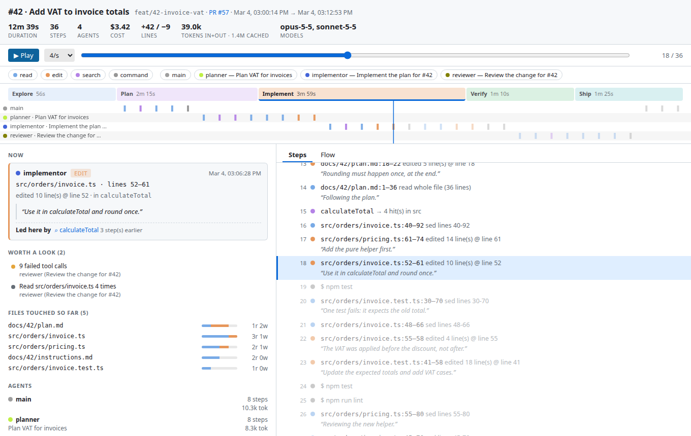
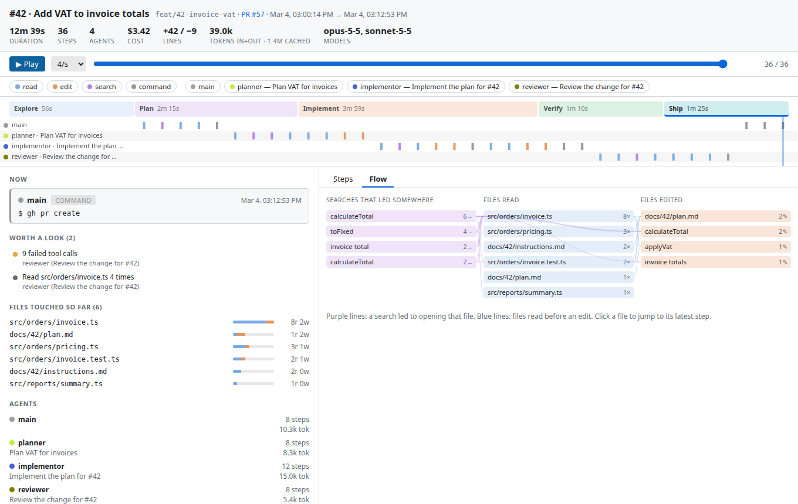
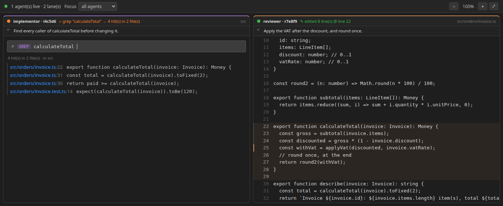

<p align="center">
  
</p>

<h1 align="center">Spiderling</h1>

<p align="center">
  <b>See what your AI coding agents actually did.</b><br>
  A little spider crawls your code while Claude Code, Codex and Antigravity read, search and edit,<br>
  and every session becomes a trace you can replay, review and share.
</p>

<p align="center">
  <a href="https://github.com/EliasHridoy/spiderling/actions/workflows/ci.yml"></a>
  
  
</p>



## Why

An agent can read forty files and make a dozen edits before you look up. Was it
heading the right way? Why did it change *that* line? What did it do between the
plan and the pull request? The diff shows what changed, not how it got there.

Spiderling reads the logs your agents already write and turns them into something you
can watch live and review afterwards. **Nothing to install in the agents, no
proxy, no terminal wrapper, no network.**

## What you get

- **Live view (Code Crawl).** One lane per agent. The spider walks the exact lines an
  agent reads, weaves a web over the lines it edits, **types its searches into a search
  box and walks the hits**, and when the agent opens one of those hits it crawls from
  the hit into the file. An agent that reads twenty files in a burst is followed file
  by file, and the lane catches up instead of falling behind.
- **Overview (Crawl Map).** Files as nodes, a spider per agent crawling between them,
  and a full recap of every step.
- **Replay.** Every session is written to a trace file you can scrub like a video:
  - a **timeline** with one lane per agent (and idle gaps marked),
  - **phases** (explore → plan → implement → verify → ship) as a band you can click,
  - the **agent's own words** next to each step: the "why",
  - **what led to each step**: "led here by ⌕ *query*" and "context for this edit",
  - **worth a look**: a file re-read nine times, the same lines rewritten, a run of
    searches that found nothing, failed tool calls, long idle time,
  - a **Flow** view: searches → files read → files edited,
  - the **function** around an edit ("edited `calculateTotal`") for live steps.
- **From code to trace.** Select code, right-click → *Show Agent Trace for This Code*:
  pick the step that wrote those lines and the replay opens right there, with the
  agent's reason. The answer to "why is this line like this?".
- **Share it.** Export a trace as one self-contained HTML file anyone can open, or
  copy a short markdown summary for a pull request.





## Supported agents

| Agent | Where its log is read from | What Spiderling gets |
| --- | --- | --- |
| **Claude Code** | `~/.claude/projects/…/<session>.jsonl` and its `subagents/` | Reads and edits with exact lines, shell reads/searches, subagents, captions, tokens, cost, the PR it opened |
| **Codex CLI** | `~/.codex/sessions/YYYY/MM/DD/rollout-*.jsonl` | Shell reads/searches, exact edit lines from `apply_patch` diffs, captions, tokens |
| **Antigravity CLI** | `~/.gemini/antigravity-cli/brain/<conversation>/.system_generated/logs/transcript_full.jsonl` | Reads with line ranges, edits, shell, find/grep/list, captions, tokens |

Only sessions that worked **in the folder you have open, or in another git worktree of
the same repository**, are read; other projects' logs are never opened past their
first few lines. Details and per-agent limits: [docs/AGENT_SUPPORT.md](docs/AGENT_SUPPORT.md).

## Install

**From the Marketplace** (recommended): open the Extensions view in VS Code, search for
**Spiderling**, and click *Install*. Or from a terminal:

```bash
code --install-extension eliashridoy.spiderling
```

The extension page is
[marketplace.visualstudio.com/items?itemName=eliashridoy.spiderling](https://marketplace.visualstudio.com/items?itemName=eliashridoy.spiderling).

**From a release** (for editors without the Marketplace, or to try a specific version):

1. Download `spiderling-<version>.vsix` from the
   [Releases](https://github.com/EliasHridoy/spiderling/releases) page.
2. `code --install-extension spiderling-<version>.vsix`
   (or Extensions → `…` → *Install from VSIX…*), then reload the window.

**From source:**

```bash
git clone https://github.com/EliasHridoy/spiderling.git
cd spiderling
npm install
npm run package            # builds spiderling-<version>.vsix
code --install-extension spiderling-*.vsix
```

Needs VS Code 1.84 or newer. Function names on edits need Node 22+ in VS Code
(current VS Code has it) and a [CodeGraph](https://github.com/colbymchenry/codegraph)
index in the repo; without them everything else works and edits just show their lines.

## Quick start

1. Open the folder you will run an agent in (File → Open Folder).
2. Run your agent as usual, in any terminal.
3. A bug icon with the number of agents and files appears in the status bar, and
   the **Spiderling** view appears in the Explorer.
4. Command Palette (`Ctrl/Cmd+Shift+P`):
   - **Spiderling: Open Code Crawl**: the live view; keep it beside your editor.
   - **Spiderling: Open Trace Replay**: the review page; it follows the trace live
     while the agent is still running.
   - **Spiderling: Open Crawl Map**: the overview and recap.

On start it also replays the last hour of sessions (`spiderling.sessionLookbackMinutes`),
so a session you started a few minutes ago is already there.

## Commands

| Command | What it does |
| --- | --- |
| **Spiderling: Open Code Crawl** | Live lanes, one per agent |
| **Spiderling: Open Crawl Map** | Files and agents as a map, with the full recap |
| **Spiderling: Open Trace Replay** | Replay a session: timeline, phases, reasons, flow |
| **Spiderling: Show Agent Trace for This Code** | (editor menu) The steps that wrote or read the selected lines |
| **Spiderling: Export Trace as HTML** | One self-contained `.html` file, next to the trace |
| **Spiderling: Copy Trace Summary** | A short markdown summary for a PR description |
| **Spiderling: Toggle Gutter Spider** | The little spider in the gutter of files an agent just touched |
| **Spiderling: Clear Activity** | Reset the live views |

## Settings

| Setting | Default | |
| --- | --- | --- |
| `spiderling.agentSources` | all three | Which agents to follow: `claude`, `codex`, `antigravity` |
| `spiderling.sessionLookbackMinutes` | `60` | On start, replay sessions active within this window |
| `spiderling.writeTraceFile` | `true` | Write each session to a trace file |
| `spiderling.traceFolder` | `.spiderling/traces` | Where traces go (workspace-relative or absolute). The default folder ignores itself in git |
| `spiderling.traceNextToIssueDocs` | `false` | Write a session that worked in `docs/<n>/` to `docs/<n>/agent-trace.json` instead |
| `spiderling.resolveSymbols` | `true` | Name the function around live edits from the repo's CodeGraph index |
| `spiderling.showDecorations` | `true` | Gutter spider and line highlight on files an agent touched |
| `spiderling.decorationTtlMs` | `4000` | How long the gutter spider lingers |
| `spiderling.autoRevealOnWrite` | `false` | Open a file in the editor when an agent writes it |
| `spiderling.trailLength` | `8` | Recent files each agent's trail connects on the map |

Reload the window after changing the capture and trace settings.

## Traces and privacy

- **Everything stays on your machine.** Spiderling only reads local log files and writes
  local trace files. It makes no network requests.
- A trace holds **paths, line ranges, search queries, the paths a search found, the
  agent's one-line explanations, failed-call counts and token/cost metrics**. It never
  stores file contents or tool output.
- **Credentials are masked** before anything is written: well-known token formats
  (GitHub, AWS, Slack, Anthropic/OpenAI, Google, npm, GitLab, Stripe, JWTs), private
  keys, `user:password@host` URLs, `Authorization`/`Bearer` values, `--password`-style
  flags and `name=value` assignments of secret-looking names. This is pattern-based:
  a secret with no telltale format or name can slip through, so skim a trace before
  sharing it. Paths under your home directory are written as `~`.
- Trace files are one JSON file per session in `.spiderling/traces/`, a folder that
  ignores itself in git. Format: [docs/TRACE_FORMAT.md](docs/TRACE_FORMAT.md).

## Good to know

- A step appears when a tool call **finishes**, so a lane is quiet while an agent is
  only thinking or waiting for you to approve something. Agents' thinking is not in
  their logs (Claude Code stores it redacted), so explanations come from what the
  agent wrote between tool calls.
- **Phases are a guide, not a log.** They are inferred from agent names, what was edited
  and which commands ran, so unusual setups get less precise labels.
- The agents' log formats are undocumented and change between versions. Spiderling
  reads them defensively and skips what it does not understand; if a new version
  breaks something, please [open an issue](https://github.com/EliasHridoy/spiderling/issues).
- Antigravity logs carry no tool-call ids, so exit codes and hits are attached only
  when a turn made a single call; its `grep_search` hit lists are not in the log.

## Documentation

- [Architecture](docs/ARCHITECTURE.md): how the pieces fit together
- [Trace format](docs/TRACE_FORMAT.md): the JSON file, field by field
- [Agent support](docs/AGENT_SUPPORT.md): what is read from each agent, and how to add one
- [Roadmap](docs/ROADMAP.md): what is planned and what is not
- [Contributing](CONTRIBUTING.md) · [Changelog](CHANGELOG.md) · [Security](SECURITY.md)

## License

[MIT](LICENSE) © Elias Hridoy
